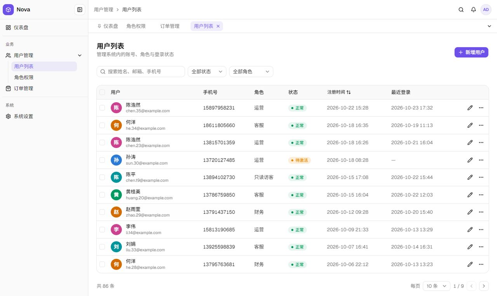

# admin-frontend-stack

一个给 AI 用的**后台管理前端 skill**：用固定、成熟的技术栈（React + TypeScript + Tailwind + shadcn/ui + Lucide + TanStack + Zustand），让 AI 一次就做出风格统一、依赖干净、可以长期维护的后台界面。

**在线示例：<https://just-liuyi.github.io/admin-frontend-stack/>**　演示账号 `admin` / `123456`，短信验证码 `123456`（数据全部是本地假数据）。

| 登录页 | 后台外壳 |
|---|---|
|  |  |

## 这个 skill 规定了什么

| 方面 | 内容 |
|---|---|
| 技术栈 | 每类功能只用一个库（图标只用 Lucide、动画只用 Motion……），已有项目优先沿用；附依赖体检脚本 `scripts/check_deps.mjs` |
| 导航外壳 | 收放按钮在侧边栏顶部；最多两级菜单，折叠后点击图标弹出子菜单；个人入口在右上角；自动生成的 SVG 头像；手机端变成抽屉 |
| 多页签 | 默认开启；右键或 ⌄ 按钮可刷新 / 关闭 / 关闭左侧 / 关闭右侧 / 关闭其他 / 关闭全部；切换页签保留页面状态；最多 10 个 |
| 登录页 | 左右分栏，左边是会互动的小人（跟随鼠标、输入密码时偷看、显示密码时回避、登录失败时摇头，颜色每次随机）；账号密码与手机验证码两种登录方式；登录守卫与安全回跳 |
| 页面原型 | 列表页、表单、详情页、仪表盘的固定结构，以及加载、空数据、出错、无权限四种状态 |
| 设计规范 | 只用语义颜色变量，深浅色自动适配；图标色块、插画、Logo 规则 |
| 踩坑记录 | 实测发现的问题和正确写法（shadcn 组件的默认缺陷、依赖冲突、浏览器行为等） |

skill 里的代码都在真实项目中经过编译和浏览器实测；从零搭建的步骤（`references/quickstart.md`）在全新的空项目里验证过。

## 怎么用

1. 在 [Releases](https://github.com/just-liuyi/admin-frontend-stack/releases) 下载 `admin-frontend-stack.skill`（本质是一个 zip 压缩包），或直接使用本仓库的 `skill/admin-frontend-stack/` 目录。
2. 导入到支持 Agent Skills 的 AI 工具中。例如 Claude Code：把 `admin-frontend-stack` 目录放到 `~/.claude/skills/` 下。
3. 之后让 AI 做后台、管理系统、仪表盘、登录页之类的界面，它会自动按这份规范来做。

不支持 skill 的 AI（例如网页版聊天）：可以把 `SKILL.md` 的内容贴给它，核心规则都写在 `SKILL.md` 里；但它看不到 `references/` 里的详细说明和 `assets/` 里的代码，效果会打折扣。

## 本地运行示例

```bash
cd demo
npm ci
npm run dev
```

需要 Node.js 20.19+ 或 22.12+。

## 目录

```
skill/admin-frontend-stack/
  SKILL.md           核心规则（AI 首先读这个）
  references/        各主题的详细规范：quickstart、navigation、tabs、login、patterns、stack 等
  assets/            验证过的代码，直接复制使用；previews/ 是效果图
  scripts/           依赖体检脚本
demo/                在线示例的源码（按 skill 搭建）
```

## 许可证

[MIT](LICENSE)
